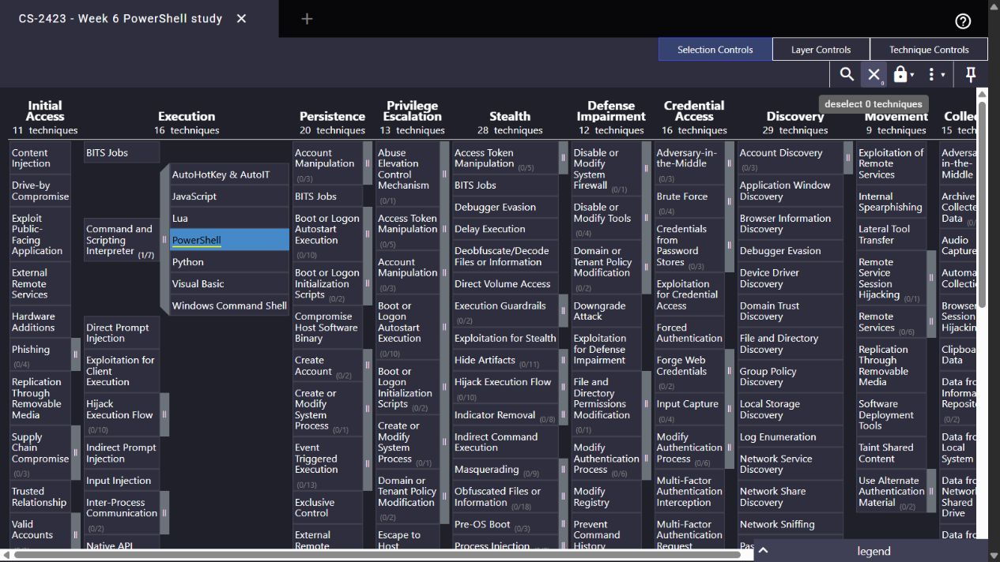

# Week 6 - ATT&CK analysis of PowerShell execution

**Group:** CS-2423 | **Project:** CTI and LLM-assisted SOC | **Assignment 4, part 1**

## 1. Task and decision

Section 3.3 of the 2026-2027 syllabus asks us to study one technique, simulate relevant activity and map the results to ATT&CK. We selected [T1059.001 - PowerShell](https://attack.mitre.org/techniques/T1059/001/) because our existing Week 5 experiment already contains genuine PowerShell events and checked search results. This gives us evidence to inspect rather than an unrelated example to describe.

We reuse the completed **8 October 2026 UTC** experiment, not claim a second execution for Week 6. Its four harmless commands print training markers. This is a limited behavioral simulation: it exercises interpreter startup and selected command-line flags, not a complete adversary operation.

## 2. Tactic, technique and procedure

| Concept | Meaning | Application here |
|---|---|---|
| Tactic | The objective of an adversary action | Execution |
| Technique | A method for achieving that objective | T1059, Command and Scripting Interpreter |
| Sub-technique | A more specific method | T1059.001, PowerShell |
| Procedure | A concrete implementation of behavior | Our collector starts powershell.exe with a marker-printing payload and selected flags |

The mapping describes behavior. It does not assign malicious intent to administrative tools or benign controls. ATT&CK procedure examples describe real reported uses; our own commands remain lab procedures, not evidence of a named actor.

## 3. Existing simulation and evidence

[The Week 5 collector](../week5/collect_lab_events.ps1) launched these cases and checked their output and exit status. [The collection manifest](../week5/data/collection-manifest.json) records the run interval, native record IDs and hashes. [The native XML](../week5/data/windows-events.xml) and [indexing dataset](../week5/data/powershell-events.jsonl) are available for inspection.

| Case | Command-line property | Event 400 record | Mapping | Known outcome |
|---|---|---:|---|---|
| plain | Plain command | 6567 | T1059.001 / Execution | Benign marker printed |
| encoded | EncodedCommand | 6575 | T1059.001 / Execution | Benign marker printed |
| hidden | WindowStyle Hidden | 6583 | T1059.001 / Execution | Benign marker printed |
| encoded_hidden | Both arguments | 6591 | T1059.001 / Execution | Benign marker printed |

All child windows were also suppressed by the collector's launch option. The table concerns arguments recorded in HostApplication. These are different observations.

Encoding changes how a command is supplied; hidden-window arguments affect its presentation. Neither property alone establishes evasion. We do not add persistence, credential access or command-and-control mappings without evidence of those behaviors.

## 4. Search results and interpretation

The [archived actual Elastic results](../week5/evidence/live-run/hunt-results.json) contain the executed queries and responses:

| Search | Matches | Interpretation |
|---|---:|---|
| Baseline PowerShell | 4 | All known controls |
| Full EncodedCommand flag | 2 | Two encoded controls |
| Full EncodedCommand plus Hidden | 1 | Combined control |

Filtering reduced the review population from four to one. The remaining command still printed a benign marker. Consequently, this experiment demonstrates candidate selection, not successful detection of an infection. With no malicious cases, malware recall cannot be calculated.

The original full-flag search also has an important boundary: it does not cover the abbreviated `-e` executor used in the Week 9 Atomic test. [Week 9](../week9/week9-report.md) documents this gap and a separately tested extension.

## 5. Navigator artifact

[The actual Navigator layer](navigator/powershell-layer.json) highlights only T1059.001 under Execution. Blue means **studied using benign lab evidence**. We deliberately omit numerical coverage scores because we did not measure coverage. The parent T1059 expands to show its sub-techniques.

Import the JSON into [ATT&CK Navigator](https://mitre-attack.github.io/attack-navigator/) using Open Existing Layer -> Upload from local. Layer format follows [MITRE's version 4.5 definition](https://github.com/mitre-attack/attack-navigator/blob/master/layers/spec/v4.5/layerformat.md). A local artifact check and a visual import are different checks; see the image caption for the observed UI result.

The layer was loaded successfully in Navigator **5.3.2**. This is an actual interface capture of the imported file; the visible current matrix uses the Stealth and Defense Impairment tactic labels. No score was assigned.

## 6. Limits and SOC value

Event 400 corroborates engine startup and HostApplication, not a complete process tree, every executed statement or network activity. Our dataset is four benign controls. [Microsoft's logging documentation](https://learn.microsoft.com/en-us/powershell/module/microsoft.powershell.core/about/about_logging_windows) describes the separate role of PowerShell logging; process-creation and script-block telemetry would add context.

For the project, a useful analyst packet preserves the native record ID, command, query result, ATT&CK mapping, benign ground truth and missing context. An LLM may help explain that packet, but the experiment does not deploy an LLM or let generated prose replace evidence.
