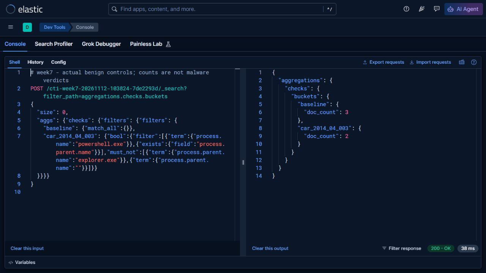

# Week 7 - Implementing CAR-2014-04-003 in Elastic

**Group:** CS-2423 | **Project:** CTI and LLM-assisted SOC | **Assignment 4, part 2**

## 1. Task and selected analytic

The syllabus requires selecting a CAR analytic, implementing it in a SIEM and mapping it to ATT&CK. We selected [CAR-2014-04-003, PowerShell Execution](https://car.mitre.org/analytics/CAR-2014-04-003/) to extend our existing PowerShell investigation. Unlike an encoded-command search, its core condition is a PowerShell executable with a parent other than explorer.exe. It uses process creation context, including executable and parent executable.

An **analytic** describes a data-based method. A **detection implementation** applies it to actual telemetry. An **alert** is a configured notification from that implementation. A matching row is an observation to review; it is not itself a confirmed incident. This lab implements and executes the search, not a scheduled Elastic Security alert rule.

## 2. Why we collected new data

The Week 5 Event 400 dataset lacks reliable parent-process context. Inferring a parent from the child command line would change the meaning of the analytic. Instead, on **12 November 2026** we launched three known benign processes and sampled their native `Win32_Process` records while they were alive.

[The collector](../tools/collect_training.ps1) obtains each actual child PID, then reads Name, ParentProcessId, CommandLine and CreationDate through CIM. It resolves the parent separately and checks that the parent was created before the child to guard against PID reuse. Collection is limited to our known child PIDs. PowerShell Event 400 XML corroborates the two PowerShell startups; it is **not** used as the parent source.

This is an explicit adaptation of the CAR process-create data source to controlled-launch process snapshots. It preserves the executable/parent condition, but snapshot collection can miss short-lived processes and is not a continuous production sensor. A four-second harmless delay allows observation without changing system audit policy. We did not collect Sysmon, Security 4688 or Event 4104.

## 3. Field mapping and actual query

| CAR concept | Collected value | Elastic field | Transformation |
|---|---|---|---|
| process executable | Native Name | process.name | Lowercase basename |
| parent executable | Name resolved from native ParentProcessId | process.parent.name | Lowercase basename |
| process context | Native CommandLine | process.command_line | Keyword; disclosed run-path redaction |
| event time | Native CreationDate | @timestamp | UTC |
| observation time | Actual sampling time | observation.sampled_at_utc | UTC; not presented as creation time |

The executed [queries](evidence/live-run/queries.json) use exact keyword filters. PowerShell must equal `powershell.exe`; the parent must exist, be nonempty and differ from `explorer.exe`. Explicit existence checking matters: a negated explorer condition alone can admit records with no parent field.

Ground-truth labels and case IDs are used **after** querying to verify expected results; they are not selection conditions. [The runner](../tools/run_training_analytics.py) creates a separate index, checks every bulk item, rejects timeouts/failed shards and compares returned case sets and exact totals.

## 4. Actual lab results

Elasticsearch **9.5.6** executed these searches on index `cti-week7-20261112-103824-7de2293d`. The lab listens on loopback port 19200; it is an isolated course environment.

| Case | Native child / parent | Baseline | CAR search | Analyst conclusion |
|---|---|---:|---:|---|
| plain | powershell.exe / pwsh.exe | Yes | Yes | Expected benign match |
| encoded | powershell.exe / pwsh.exe | Yes | Yes | Expected benign match |
| cmd_control | cmd.exe / pwsh.exe | Yes | No | Correct process-type exclusion |
| **Total** | **Three native observations** | **3** | **2** | **No confirmed attack** |

[Native observations](data/live-run/process-observations.jsonl), [Event 400 XML](data/live-run/powershell-event400.xml), [collection checks and SHA-256 hashes](data/live-run/collection-manifest.json), [actual search responses](evidence/live-run/results.json) and [full API transcript](evidence/live-run/api-transcript.json) allow the result to be traced back to its source.

The explorer-parent exclusion and missing-parent condition are additionally checked using explicitly labelled **synthetic boundary fixtures** in the verification script. We did not launch an explorer-parent native control, so the three-record lab does not establish that branch on live telemetry.

### Actual SIEM screenshots

The summary was also imported and executed in live **Kibana 9.5.6 Console**. The image shows HTTP 200, baseline=3 and CAR=2. [The exact Console import](evidence/live-run/kibana-summary.txt) and [saved aggregation API check](evidence/live-run/ui-summary-check.json) use the same search predicates as the individual searches.



This is a genuine browser capture of a new GET search against the same live Elasticsearch index, using the saved CAR predicate. `filter_path` limits displayed fields; it does not alter the query. The response shows an exact total of 2 and the native child/parent names. It is an Elasticsearch API page, not a Kibana interface screenshot. The full responses remain in the evidence folder.

[Supplementary actual API screenshot: two PowerShell processes with pwsh.exe parents](images/01-car-elastic-live.jpg).

## 5. ATT&CK mapping and analyst action

The studied behavior maps to [T1059.001 / Execution](https://attack.mitre.org/techniques/T1059/001/). CAR's historical coverage annotations are source metadata; they do not establish defense evasion in our benign processes.

A non-explorer parent is common in administration. An analyst should inspect parent identity, decoded payload, user/host role, maintenance schedule and correlated network/file behavior before escalation. Suppression should use an approved management workflow, not a global PowerShell exclusion. Missing parent data should be treated as a visibility gap.

For an LLM-assisted SOC, the structured input should include these facts, source paths and limits. The LLM may summarize them, while the analyst owns the verdict. No LLM service or production notification was deployed.

## 6. Reproduction

With Python 3.10+, PowerShell 7 on Windows and the [local lab](../docs/lab-reproduction.md):

```powershell
./tools/collect_training.ps1 -Mode car -OutputDirectory ../my-car-data
python tools/run_training_analytics.py car --data ../my-car-data/process-observations.jsonl --output ../my-car-results
```

Both output folders must be new or empty. Use the [saved Console requests](evidence/live-run/kibana-console.txt) to inspect the archived index in Kibana. Replays receive a new index; do not overwrite the original evidence.
