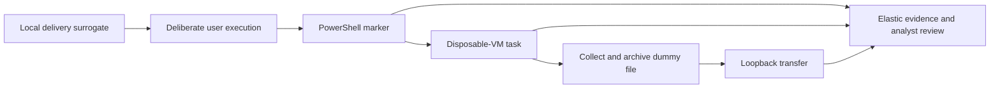

# Week 8 - Adversary emulation plan for our SOC project

**Group:** CS-2423 | **Assignment 5** | **Status:** documented plan, not a claim that every phase was executed

## 1. Objective and scope

Section 3.3 requires a simple emulation plan spanning initial access, persistence and data exfiltration, documented using ATT&CK. Our question is: **can an analyst connect a staged user action, PowerShell execution, persistence attempt and transfer of dummy data into one evidence-based investigation?**

The plan uses one disposable Windows VM, a loopback HTTP receiver and a local Elastic lab. It continues the PowerShell work from Weeks 5-7. It is a generic endpoint scenario, not an assertion that a named APT followed this exact sequence. Week 10 analyzes a separately sourced APT29 case.

## 2. Preparation and responsibilities

The lab operator prepares a VM snapshot, standard test account and an isolated working folder containing only `CTI-LAB-DUMMY.txt`. The file contains the marker `CS2423-TRAINING-NO-REAL-DATA`. The collector owner checks telemetry before execution. The analyst records query results and alternative explanations. A second group member reviews the timeline and cleanup. These are roles to distribute among the actual group members, not invented individual contributions.

Use host-only networking or loopback. The only receiver is `127.0.0.1:18080`. Do not use real inboxes, production accounts, genuine credentials or external upload destinations. Stop if the target is outside the disposable lab, the receiver binds beyond loopback, dummy-data hashes differ, or required logging is absent. A successful command with missing telemetry is a failed visibility test, not a successful detection test.

## 3. Planned sequence and acceptance criteria

| Step | ATT&CK / tactic | Controlled procedure | Evidence and success condition | Reset |
|---|---|---|---|---|
| 1 | [T1566.002](https://attack.mitre.org/techniques/T1566/002/) / Initial Access | Represent an email link with a locally stored training message; do not send mail | Message artifact identifies a local-only dummy file. This is a delivery **surrogate**, not real phishing telemetry | Remove training message |
| 2 | [T1204.002](https://attack.mitre.org/techniques/T1204/002/) / Execution | Operator deliberately opens the harmless training script inside the VM | Timestamped operator action plus child process context; no automated claim of a deceived user | Close test process |
| 3 | [T1059.001](https://attack.mitre.org/techniques/T1059/001/) / Execution | Script prints a run marker; optional UTF-16LE encoded variant | Process/parent fields and PowerShell event; CAR search returns the supported candidate | Wait for process exit |
| 4 | [T1053.005](https://attack.mitre.org/techniques/T1053/005/) / Persistence | In disposable VM only, create one clearly named task `CTI-LAB-ONLY` whose action prints the marker at a future test trigger | Task definition, registration event and observed test-trigger execution; registration alone does not prove persistence worked | Delete exact test task and verify absence; restore snapshot |
| 5 | [T1005](https://attack.mitre.org/techniques/T1005/) / Collection | Read only the prepared dummy file into a staging folder | File hashes before/after and relevant file telemetry; no personal directories | Remove exact staging files |
| 6 | [T1560.001](https://attack.mitre.org/techniques/T1560/001/) / Collection | Archive only that dummy file with a standard utility | Archive hash, inspected member list containing one expected file and process command | Remove exact archive |
| 7 | [T1041](https://attack.mitre.org/techniques/T1041/) / Exfiltration | Send the dummy archive over the pre-established **simulated control channel** to the loopback receiver | Receiver bytes/hash equal sender archive and a time-correlated network record | Stop receiver; remove received test archive |

Step 7 emulates a transfer over a designated control channel, but loopback is not an enterprise boundary crossing. It cannot demonstrate real-world exfiltration prevention or a functioning attacker C2 infrastructure. Step 1 similarly substitutes local delivery for mail flow. These substitutions reduce realism and must remain visible in the outcome.



## 4. Telemetry and queries to prepare

For a fuller VM execution, collect Sysmon process creation/network/file telemetry or equivalent sources and inspect the actual fields. Enable suitable task-registration and PowerShell logging inside that VM before taking the baseline snapshot. Event 400 alone cannot establish a scheduled task, file read or network transfer. Some file reads are not recorded by default; verify the chosen audit configuration instead of assuming visibility.

Preserve UTC timestamps, host alias, run ID, child/parent IDs, command lines, task name, file hashes and receiver logs. Correlate using host + run interval + PID/lineage, accounting for PID reuse. Queries must operate on actual activity fields; a training run ID can scope a lab but must not stand in for behavior-based detection.

Minimum analytic checks: CAR PowerShell parent condition; test task registration plus action execution; archive utility with the exact dummy path; transfer associated with that process. The task/file/network rules require telemetry beyond our completed Week 7 snapshots. They are planned checks, not already measured coverage.

## 5. Evaluation and evidence contract

Run a plain marker baseline before the encoded variant. Compare matched cases, missing fields and observed delays. A benign administrative task is a necessary negative context when later evaluating alert noise. Do not calculate production accuracy from one chain.

Each executed step should produce: command or operator action, source observation, UTC interval, expected behavior, actual result, hash where applicable, analyst verdict, uncertainty and cleanup check. If a step is blocked, stop that branch and record the unmet prerequisite. Downstream stages must not be reported as completed.

The proposed SOC handoff record is:

```json
{"run_id":"assigned_at_execution","step":3,"technique":"T1059.001","evidence_paths":[],"observed_behavior":"fill from source events","verdict":"pending analyst review","missing_context":[],"cleanup_verified":false}
```

This is a **schema example**, not a completed event. It gives an optional LLM grounded input with explicit missing context; no deployed LLM is claimed.

## 6. Why this plan

PowerShell keeps the scenario connected to our collected data and CAR analytic. A scheduled task gives a concrete persistence mechanism with a verifiable reset in a disposable VM. One dummy file makes collection, archiving and received-byte checks measurable. A loopback receiver avoids transmitting data externally while exposing the transfer mechanics, with the realism limitation acknowledged.

We reviewed [MITRE's adversary emulation plans](https://github.com/center-for-threat-informed-defense/adversary_emulation_library) and [CALDERA documentation](https://caldera.readthedocs.io/en/latest/) as planning references. CALDERA is not required for this small manual chain and was not installed. Week 9 executes only the separately selected benign atomic tests; it does not certify all steps in this plan.
