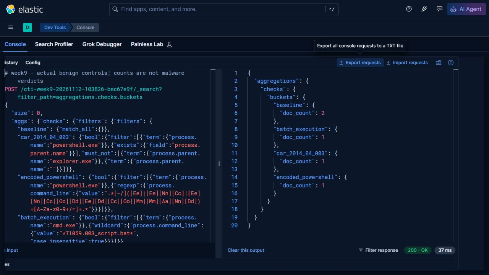

# Week 9 - Atomic Red Team tests and Elastic analysis

**Group:** CS-2423 | **Assignment 6, part 1** | **Execution:** 12 November 2026

## 1. Task and test selection

The syllabus requires running selected Atomic Red Team tests and recording/analyzing their results in a SIEM. We selected two benign interpreter tests to continue our PowerShell work without requiring credential access, exploit execution or additional payload downloads.

The definitions are pinned to Atomic Red Team commit `59ea87397c5faf8cad1e6ebe36fd625d0063e894`. Selection uses GUIDs, since test numbers can change:

| Technique | Official test | Stable GUID | Reason |
|---|---|---|---|
| T1059.001 | PowerShell Command Execution | a538de64-1c74-46ed-aa60-b995ed302598 | Exercises an encoded/obfuscated but harmless greeting; tests the abbreviated -e flag missed by our old full-flag search |
| T1059.003 | Create and Execute Batch Script | 9e8894c0-50bd-4525-a96c-d4ac78ece388 | Adds a different interpreter and a small file artifact with an explicit cleanup check |

Sources: [pinned PowerShell definition](https://github.com/redcanaryco/atomic-red-team/blob/59ea87397c5faf8cad1e6ebe36fd625d0063e894/atomics/T1059.001/T1059.001.yaml), [pinned command-shell definition](https://github.com/redcanaryco/atomic-red-team/blob/59ea87397c5faf8cad1e6ebe36fd625d0063e894/atomics/T1059.003/T1059.003.yaml).

## 2. Execution method and parameter changes

[The collector](../tools/collect_training.ps1) directly executed reviewed, parameterized commands from these official tests. We did **not** install or invoke the Invoke-AtomicRedTeam module. Direct execution keeps the relevant official executors while allowing us to inspect the selected payloads and collect actual process context.

For the PowerShell test, the original command-prompt executor runs `powershell.exe -e #{obfuscated_code}`. The original harmless greeting expression was decoded and reviewed. We appended a four-second `Start-Sleep` to its input before re-encoding so the child remained alive for a native process snapshot. The greeting and the command-prompt executor exit status were checked; the native PowerShell child has cmd.exe as its observed parent.

For the batch test, the original executor is `Start-Process "#{script_path}"`. We supplied an isolated script path and a command body that prints a training marker and sends five ICMP requests only to 127.0.0.1 for observation time. The process exited successfully and the exact created batch file was removed. Its output was not captured through the shell-association executor; we do not claim a stdout assertion for this test.

These are disclosed input overrides, not a claim that default inputs were executed unchanged. [The selection record](data/live-run/atomic-selection.json) stores the GUIDs, actual encoded input, decoded default, substitutions and cleanup result.

## 3. Native collection and SIEM ingestion

Two native CIM process snapshots were collected while the known child processes were alive. Name, PID, ParentProcessId, CommandLine and CreationDate came from Windows; the parent name was resolved separately. The PowerShell startup is corroborated by one genuine Event 400 XML record. Event 400 is not the source of parent context. This is scoped snapshot collection, not a Sysmon or Security 4688 event stream.

All public records use `CTI-LAB-HOST`. The batch run directory is replaced by `<LAB_WORKDIR>` in the published command line; CLIXML information-stream User/Computer fields are also replaced with lab aliases and normalized from OEM text to UTF-8. No username or unrelated host processes are included.

Elasticsearch **9.5.6** ingested these records into `cti-week9-20261112-103826-bec67e9f`. The [runner](../tools/run_training_analytics.py) preserved requests, mappings, ingestion responses and complete search responses. Query filters do not use the known case labels as detection conditions.

## 4. Actual results

| Search | Actual count | Cases | Meaning |
|---|---:|---|---|
| Baseline | 2 | Both atomic cases | Both observations indexed |
| CAR parent-based PowerShell | 1 | art_powershell | Expected PowerShell behavior match |
| Encoded PowerShell including -e | 1 | art_powershell | Abbreviated encoded executor recognized |
| Batch execution | 1 | art_batch | cmd.exe with the selected batch path recognized |

[The actual results](evidence/live-run/results.json), [full API transcript](evidence/live-run/api-transcript.json), [queries](evidence/live-run/queries.json), [native dataset](data/live-run/process-observations.jsonl), [Event 400 XML](data/live-run/powershell-event400.xml) and [collection/hash manifest](data/live-run/collection-manifest.json) support these counts.

The encoded query adds explicitly supported forms `-e`, `-enc` and `-EncodedCommand` (and slash equivalents) to the PowerShell filter. It is a narrow argument-pattern search, not a complete Windows command-line parser. Quoted payload text can contain misleading flag-like strings, other valid abbreviations may be missed, and in-process PowerShell can avoid powershell.exe entirely. More robust parsing and script telemetry are next steps.

The batch search intentionally recognizes this test's filename. It is an exercise-specific validation, not a general batch-based malware detector. A real SOC rule would need a broader behavioral hypothesis, parent context and a normal-activity baseline.

### Actual SIEM screenshots

The summary was imported and executed in live **Kibana 9.5.6 Console**, returning HTTP 200. [The Console import](evidence/live-run/kibana-summary.txt) and [saved aggregation API check](evidence/live-run/ui-summary-check.json) preserve its request and expected result.



The following image is a genuine browser capture of a live Elasticsearch filter aggregation. It reuses each saved search predicate to show baseline=2 and one match for each analytic. [The exact summary request](evidence/live-run/browser-summary-request.json) identifies its index and body. Display filtering only trims the response. This is an API response page, not a mockup or a Kibana screenshot.

[Supplementary actual API screenshot of the Atomic summary](images/01-atomic-elastic-live.jpg).

## 5. Analyst conclusion and cleanup

Both tests are benign. The PowerShell payload prints a greeting; the batch body prints a marker and waits through loopback ICMP. A query hit proves the query condition matched the stored observation. It does not establish an intrusion, production precision or recall against malicious activity.

The PowerShell case exited with code 0 and its greeting was checked. The batch case exited with code 0; the collector checked that its exact temporary batch file no longer existed. No task, registry persistence, credential material or external control channel was created by these selected tests. Evidence exports remain intentionally available for review.

## 6. Reproduction

With the [local Elastic lab](../docs/lab-reproduction.md), Windows PowerShell and PowerShell 7:

```powershell
./tools/collect_training.ps1 -Mode atomic -OutputDirectory ../my-atomic-data
python tools/run_training_analytics.py atomic --data ../my-atomic-data/process-observations.jsonl --output ../my-atomic-results
```

Use new output folders. The script fails if the child exits before observation, its parent cannot be verified, the PowerShell output differs, a required Event 400 is missing or the search returns unexpected cases. A failed run should be investigated rather than completed with invented records.
